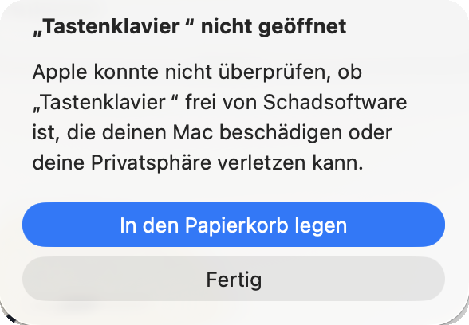
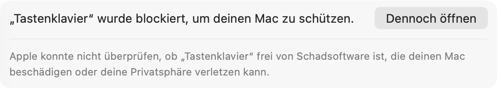
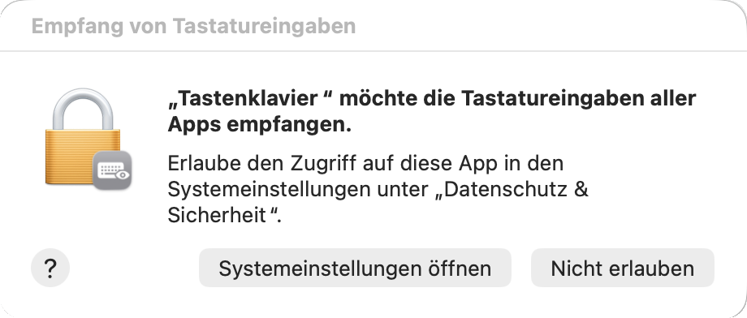

# Tastenklavier

Jede Taste ein Ton. Tastenklavier lebt in der Menüleiste deines Macs und macht aus allem, was du tippst, eine kleine Melodie, egal ob in Word, Mail oder im Browser. Dein Tipptempo bestimmt den Rhythmus.

- **9 Instrumente:** Klavier, E-Piano, Gitarre, Harfe, Marimba, Spieluhr, Trompete, Kuh und Katze
- **6 Songs:** Pop, Klassisch, Jazz, Blues, Melancholisch, Verträumt
- Leertaste setzt den Bass, Grossbuchstaben bekommen eine zweite Stimme, ein Punkt löst auf, ein Fragezeichen bleibt offen, Enter schliesst die Phrase.

## Installieren

**[⬇ Tastenklavier herunterladen](https://github.com/cedric-schweizer/tastenklavier/releases/latest/download/Tastenklavier.dmg)** (2 MB, macOS 13 oder neuer, Apple-Chip und Intel)

1. Öffne die heruntergeladene Datei `Tastenklavier.dmg` und zieh **Tastenklavier** auf den Ordner **Applications**.
2. Öffne Tastenklavier im Programme-Ordner. Weil die App nicht über den App Store kommt, blockiert macOS sie beim ersten Mal. Klick auf **Fertig**, nicht auf «In den Papierkorb legen».

   

3. Öffne **Systemeinstellungen → Datenschutz & Sicherheit**, scrolle ganz nach unten und klick auf **Dennoch öffnen**. Bestätige mit deinem Passwort oder Touch ID.

   

4. Tastenklavier fragt nach dem Zugriff auf die Tastatur. Klick auf **Systemeinstellungen öffnen** und schalte Tastenklavier unter **Eingabeüberwachung** ein. Ein Ton bestätigt, dass alles klappt.

   

Das ist alles und nur beim ersten Mal nötig. **Tastenklavier hat kein Fenster und kein Symbol im Dock:** Es lebt oben rechts in der Menüleiste als kleines Klaviertasten-Symbol. Dort wählst du Instrument, Song und Lautstärke, pausierst oder beendest die App.

## Datenschutz

Tastenklavier muss Tastendrücke mithören, um Töne zu spielen. Es speichert nichts, sendet nichts und nutzt kein Internet. Der gesamte Quellcode liegt in diesem Repository.

## Hinweis zu Updates

Weil die App nicht mit einem Apple-Entwicklerzertifikat signiert ist, verlangt macOS nach einem Update eventuell erneut die Erlaubnis zur Eingabeüberwachung. Falls nach einem Update nichts klingt: In den Systemeinstellungen Tastenklavier aus der Liste entfernen (−) und neu einschalten.

## Selbst bauen

Die App wird automatisch von GitHub Actions gebaut (`.github/workflows/build.yml`). Lokal genügt ein Mac mit den Xcode Command Line Tools:

```
swiftc -O Sources/*.swift -o Tastenklavier
```

Die Instrumentenklänge stammen aus der General-MIDI-Klangbibliothek, die macOS mitbringt. Kuh und Katze werden per Formant-Synthese erzeugt.
