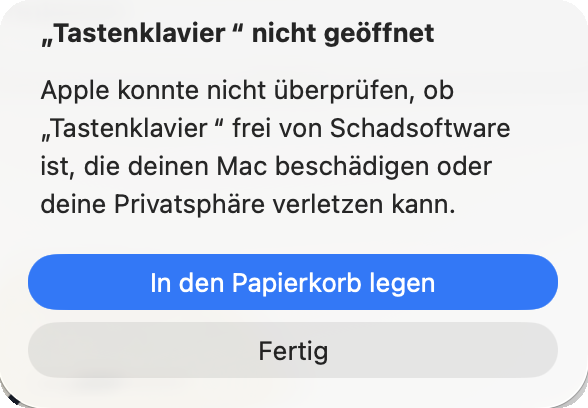
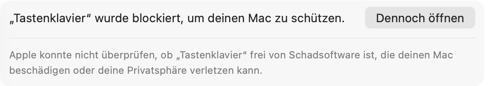
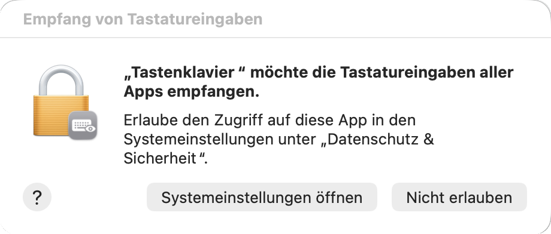

Jede Taste ein Ton: Tastenklavier macht aus allem, was du tippst, eine kleine Melodie, in jedem Programm.

Lade unten **Tastenklavier.dmg** herunter (2 MB, macOS 13 oder neuer, Apple-Chip und Intel)

1. Öffne die heruntergeladene Datei `Tastenklavier.dmg` und zieh **Tastenklavier** auf den Ordner **Applications**.
2. Öffne Tastenklavier im Programme-Ordner. Weil die App nicht über den App Store kommt, blockiert macOS sie beim ersten Mal. Klick auf **Fertig**, nicht auf «In den Papierkorb legen».

   

3. Öffne **Systemeinstellungen → Datenschutz & Sicherheit**, scrolle ganz nach unten und klick auf **Dennoch öffnen**. Bestätige mit deinem Passwort oder Touch ID.

   

4. Tastenklavier fragt nach dem Zugriff auf die Tastatur. Klick auf **Systemeinstellungen öffnen** und schalte Tastenklavier unter **Eingabeüberwachung** ein. Ein Ton bestätigt, dass alles klappt.

   

Das ist alles und nur beim ersten Mal nötig. **Tastenklavier hat kein Fenster und kein Symbol im Dock:** Es lebt oben rechts in der Menüleiste als kleines Klaviertasten-Symbol. Dort wählst du Instrument, Song und Lautstärke, pausierst oder beendest die App.

